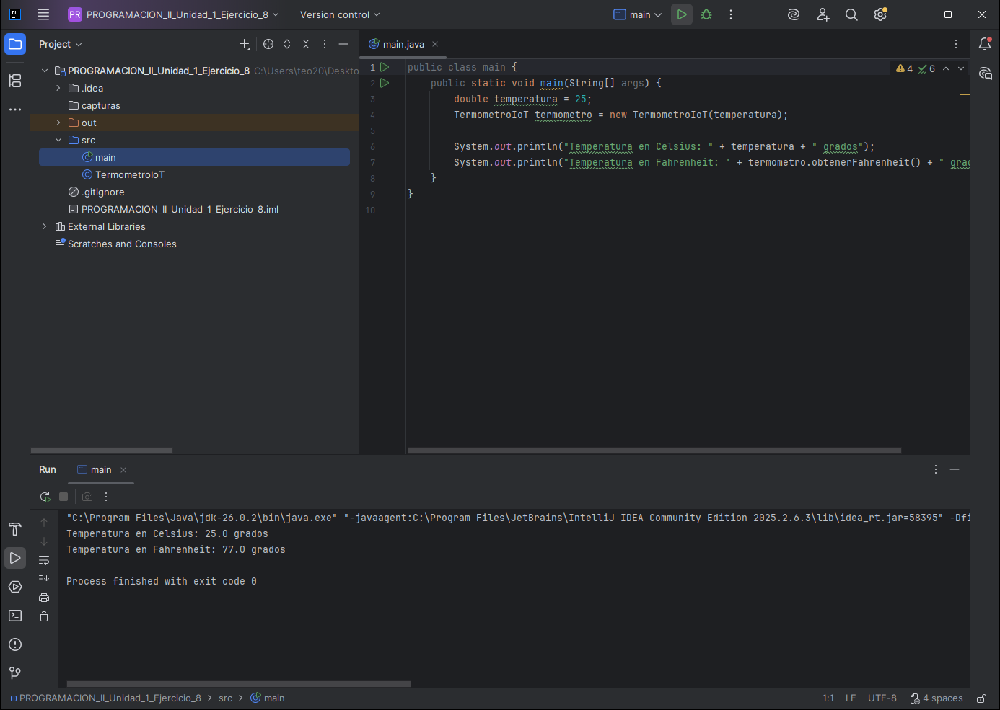

# PROGRAMACIÓN II — Unidad 1, Ejercicio 8: Simulación de un Termómetro Digital

Trabajo práctico de Programación II. Este repositorio contiene la resolución en Java del ejercicio 8 de la Unidad 1.

## Consigna

#### Contexto

En la implementación de aplicaciones IoT (Internet of Things), los sensores térmicos capturan la temperatura en una unidad métrica y el software debe convertirla para distintos estándares internacionales.

#### Consigna

Crear una clase en Java que almacene una temperatura en grados Celsius y permita su conversión a grados Fahrenheit.

#### Desarrollo requerido

- Definir la clase TermometroIoT con el atributo privado temperaturaCelsius (double).
- Incorporar un constructor que inicialice la temperatura.
- Implementar un método obtenerFahrenheit() que aplique y retorne el resultado de la siguiente fórmula matemática:
- $F = C \times \frac{9}{5} + 32$
- En el método main, instanciar el termómetro con un valor en grados Celsius, ejecutar la conversión e imprimir ambos valores térmicos.

## Estructura del repositorio

```
PROGRAMACION_II_Unidad_1_Ejercicio_8/
├── README.md
├── capturas/
│   └── consola.png
└── src/
    ├── main.java   # clase con el método main
    └── TermometroIoT.java
```

## Funcionamiento y lógica

### `TermometroIoT`

Representa un termómetro que guarda la temperatura en grados Celsius en el atributo privado `temperaturaCelsius`.

- **`obtenerFahrenheit()`:** convierte la temperatura con la fórmula `C * 9 / 5 + 32` y devuelve el resultado.

### `main`

Crea un termómetro con 25 °C y muestra la temperatura en las dos escalas: **25.0** grados Celsius equivalen a **77.0** grados Fahrenheit.

## Ejecución

Captura de la consola de IntelliJ IDEA ejecutando el programa:



Salida obtenida:

```
Temperatura en Celsius: 25.0 grados
Temperatura en Fahrenheit: 77.0 grados
```
